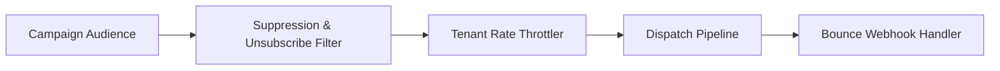

# Multi-Tenant Email Campaign Engine (TypeScript / Node.js)


**Stack:** `TypeScript · Node.js · Suppression Enforcement · Campaign Dispatch`

## Overview
A multi-tenant email campaign engine enforcing tenant-level unsubscribe and bounce suppression lists, throttled batch dispatch, and template variable rendering.

## Architecture & Execution Flow


## Key Engineering Capabilities
- **Mandatory Suppression Enforcement:** Automatically filters unsubscribed and hard-bounced recipients prior to dispatch.
- **Strict Tenant Isolation:** Separates recipient lists, suppression state, and campaign metrics per tenant.
- **Webhook Bounce Processing:** Updates tenant suppression state immediately upon bounce event ingestion.
- **Executable Test Suite:** Verified via `node --test` in CI.

## Local Verification
Run the self-contained verification suite locally:

```bash
node --test
```

## Documentation
- [Architectural Decisions](docs/DECISIONS.md)
- [Security & Isolation Model](docs/SECURITY.md)
