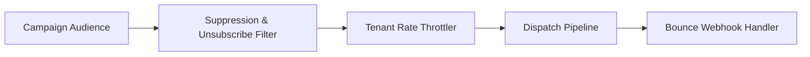

# Multi-Tenant Email Campaign Engine (TypeScript / Node.js)


**Stack:** `TypeScript · Node.js · Suppression Enforcement · Campaign Dispatch`

> [!IMPORTANT]
> **🔒 Enterprise Confidentiality & Clean-Room Reference Notice (For HR & Technical Reviewers)**
> Due to strict **Non-Disclosure Agreements (NDAs)**, SOC2/PCI-DSS security compliance, and proprietary Intellectual Property (IP) governance across enterprise production systems, the full commercial source code, internal infrastructure manifests (Terraform state, Helm charts, internal VPC/IAM topologies), and proprietary third-party adapters cannot be published to public GitHub.
>
> **What is included in this repository:**
> This repository provides a **clean-room, zero-dependency architectural reference core** written from scratch to demonstrate the underlying **domain invariants, state machines, concurrency models, and automated verification suites** without exposing proprietary business logic or client infrastructure. Full architectural walkthroughs and production trade-off discussions are available during technical interviews.

---

## Overview
A multi-tenant email campaign engine enforcing tenant-level unsubscribe and bounce suppression lists, throttled batch dispatch, and template variable rendering.

## Architecture & Execution Flow


## Key Engineering Capabilities
- **Mandatory Suppression Enforcement:** Automatically filters unsubscribed and hard-bounced recipients prior to dispatch.
- **Strict Tenant Isolation:** Separates recipient lists, suppression state, and campaign metrics per tenant.
- **Webhook Bounce Processing:** Updates tenant suppression state immediately upon bounce event ingestion.
- **Executable Test Suite:** Verified via `node --test` in CI.

## Why a Clean-Room Domain Core?
In enterprise microservices, 80% of production incidents stem from broken domain invariants (race conditions, non-idempotent retries, cross-tenant data leakage, or unbalanced state transitions) rather than HTTP/ORM boilerplate. By isolating the **pure domain engine** from proprietary cloud adapters:
1. **Confidentiality & IP Safety:** Zero proprietary client schemas, credentials, or internal endpoints are exposed.
2. **Deterministic Verification:** Reviewers can clone and execute the full invariant test suite in under 2 seconds (`node --test`) with zero external database or cloud setup required.
3. **Clear Architectural Boundaries:** Demonstrates strict separation between domain rules and infrastructure delivery.

## Local Verification
Run the self-contained verification suite locally:

```bash
node --test
```

## Documentation
- [Architectural Decisions & Trade-offs](docs/DECISIONS.md)
- [Security, NDA & Isolation Model](docs/SECURITY.md)
